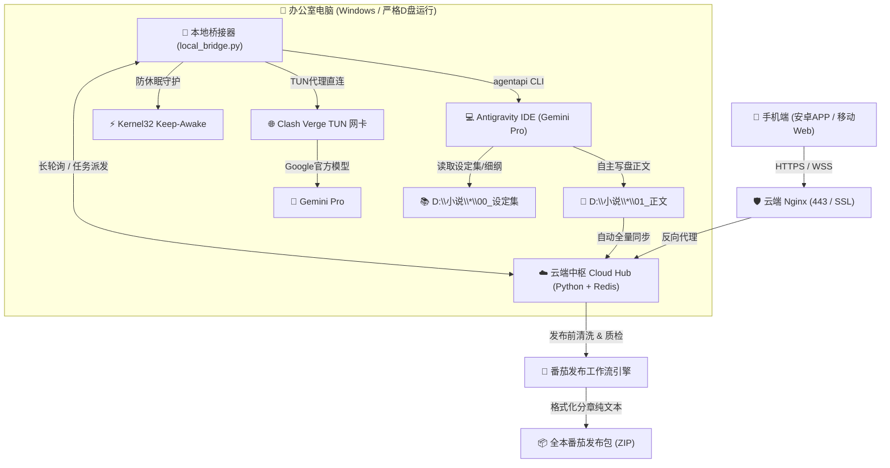

# NovelRemoteHub · 智笔云枢

<div align="center">


### 🌟 面向多书架的 AI 协同创作、远程遥控中枢与番茄小说自动化发布平台

[](https://www.python.org/)
[-green.svg)](https://developer.android.com/)
[](https://deepmind.google/technologies/gemini/)
[](https://fanqienovel.com/)
[](LICENSE)

[功能特性](#-核心特性) • [系统架构](#-系统架构) • [快速启动](#-快速启动指南) • [番茄发布工作流](#-番茄小说自动化发布工作流) • [安卓App构建](#-安卓-app-原生构建) • [API 文档](#-api-接口清单)

</div>

---

## 📖 项目简介

**NovelRemoteHub（智笔云枢）** 是一套专为网文作家、硬核小说创作者打造的高性能**多书架 AI 协同创作与自动化发布工作流系统**。

它彻底打破了传统“人在工位才能让 AI 写书、下班回家电脑关机无法操作”的局限。无论身在何处，通过手机浏览器或专用的**安卓 App**，即可公网远程调阅公司电脑中的小说正文与设定集，并跨公网一键唤醒办公室电脑中的 **Google Antigravity** 与 **Gemini Pro** 深度推理智能体，全自动根据分章细纲、前章悬念断章钩子与 SOP 创作规范继续推进剧情！

---

## ✨ 核心特性

### 1. 📚 通用多书架与新书架构体系 (Multi-Novel & Worldbuilding)
- **🚀 Antigravity 新书架构工坊**：支持在手机端一键下发全新小说构想，Antigravity 自动完成世界观构思、战力修炼体系、主要人物小传与前30章分章细纲，并在 `D:\小说\<书名>` 初始化落盘。
- **✨ 智谱工坊 · 设定大典演进**：支持在线查阅 `00_设定集`，支持一键【➕ 新增设定文档】、【✨ 深度润色扩展】与【🔍 全书正文与设定冲突排查】，设定更新即时回传落盘。
- **多作品无缝切换**：原生支持同时连载与管理多部不同题材的小说，动态递归索引正文与大纲，支持分卷折叠与全书字数看板。

### 2. 🤖 Gemini 2.0 Pro / Flash 双核执行与模型透明化
- **模型算力全透明**：控制台实时显影底座模型（`Google Gemini 2.0 Pro` / `Flash`）、会员订阅状态与 Clash Verge 全局 TUN 专线链路。
- **🌟 Gemini 2.0 Pro 智能体模式（官方首选 · 深度推理）**：
  - 远程调度办公室电脑的 Antigravity 桌面 IDE 环境，原生绑定 **Gemini Pro 会员** 深度推理算力。
  - 自主检索分章细纲、提取上一章末尾断章钩子、执行创作并调用工具写盘落盘，IDE 永久留存思考与会话树。
- **⚡ Gemini 2.0 Flash 极速流式模式**：
  - 毫秒级打字机响应，适合临时剧情灵感脑洞推演、快速语法润色与错别字排查。
- **4 大专业网文创作工坊矩阵**：
  - ✍️ **正文自动连载续写**：目标字数（4000-8000字）与剧情基调调节，自动组装大纲与断章悬念。
  - ✨ **单章精修与留存率优化**：黄金前三章留存率爆改、喜剧笑点加深、章末王炸钩子重塑。
  - 🗺️ **大纲总谱推演与伏笔设计**：推演后续20-30章主线高潮，设计势力暗线。
  - 🛠️ **自由定制创作指令**：开放式自然语言指挥。

### 3. 🍅 番茄小说自动化发布工作流 (Tomato Novel Publisher)
- **一键深度清洗排版**：自动去除 Markdown 符号，段首注入标准双全角空格缩进（`\u3000\u3000`），标点全角规范化（自动校对纠偏 `“”`）。
- **AI 机审与风控预检**：
  - 单章字数实时质检（低于 2000 字预警签约线，高于 6500 字建议拆章）。
  - 敏感词与审核风险词（如涉及风控词汇）提前标记，杜绝平台机审驳回。
- **一键复制与全本 ZIP 导出**：支持一键将排版文本复制至剪贴板（直接粘贴至番茄作家助手），或一键打包下载全本分章 `.txt` 纯净发布压缩包。

### 4. 📱 移动端与原生安卓 APP (智笔云枢)
- **纯内联矢量 Logo**：告别外部图片加载延迟与闪烁，60fps 毫秒级原生渲染。
- **优雅响应式排版**：顶部状态栏与下载按钮横向自适应对齐，移动端底部悬浮 Dock 导航栏。
- **4 套沉浸式阅读主题**：玄黑夜读、古风羊皮、竹青护眼、晨光皓白，字号行距实时微调。
- **工业级安卓 APK**：
  - 内置 AAPT2、D8 原生编译，4 字节对齐（Zipalign）。
  - 完整注入 **v1 + v2 + v3** 现代安卓多重签名方案，完美兼容 Android 11/12/13/14+。
  - 启动自动对比服务端版本并提示一键增量更新。

### 5. 🛡️ 严格 C 盘零占用与电源常驻守护
- **零占用原则**：所有构建工具、依赖、编译临时文件、运行脚本全部限制在 `D:\RuanJian\NovelRemoteHub` 与 `D:\小说`，绝不污染或占用 C 盘系统盘空间。
- **系统防休眠**：桥接端通过 Windows Kernel `SetThreadExecutionState` 调用和电源方案常驻守护，即使办公室电脑锁屏离人，系统网络与 AI 进程依旧持续待命。

---

## 🏗️ 系统架构



---

## 🚀 快速启动指南

### 1. 云端服务器部署 (Linux)

服务器环境需安装 Python 3.8+ 及可选的 Redis。

```bash
# 1. 登录服务器并创建服务目录
mkdir -p /opt/novel_hub/download /root/novel_hub_data/books

# 2. 将项目核心代码上传至 /opt/novel_hub
# cloud_hub.py, novel_manager.py, engine_router.py, index.html, novel-hub.service

# 3. 安装 systemd 服务
cp /opt/novel_hub/novel-hub.service /etc/systemd/system/
systemctl daemon-reload
systemctl enable novel-hub
systemctl restart novel-hub

# 4. 配置 Nginx 反向代理 (/novel/)
# location /novel/ {
#     proxy_pass http://127.0.0.1:8899/;
#     proxy_set_header Host $host;
#     proxy_set_header X-Real-IP $remote_addr;
# }
```

### 2. 办公室本地电脑运行 (Windows)

在办公室电脑的 `D:\RuanJian\NovelRemoteHub` 目录下：

```bat
:: 双击运行 start_bridge.bat 即可一键启动
start_bridge.bat
```

* 如需后台静默常驻，可运行 `start_silent.vbs`。
* 停止服务可双击 `stop_bridge.bat`。

---

## 🍅 番茄小说自动化发布工作流

1. **进入控制台**：在手机或 PC 浏览器打开 `https://<你的服务器IP>/novel/`。
2. **选择章节**：在**【章节卷宗】**列表点击任意章节的 **`[番茄]`** 按钮。
3. **机审与质检**：
   - 系统自动对文章进行深度清洗，段首缩进两全角空格。
   - 自动扫描敏感词与字数偏离指标。
4. **一键复制/导出**：
   - 点击 **`[📋 一键复制番茄纯净正文]`**，直接到作家助手后台粘贴。
   - 或点击 **`[📦 导出全本番茄ZIP]`** 批量导入整本分章。

---

## 📱 安卓 App 原生构建

本项目无需庞大笨重的 Android Studio，直接利用内置精简工具链在 Windows 下 5 秒完成极速原生构建与签名：

```bash
# 执行本地免装构建脚本 (绝不触碰 C 盘)
python build_apk.py
```

构建流水线会自动执行：
1. `aapt2 compile & link`：编译 AndroidManifest 与矢量资材。
2. `javac`：编译原生交互 WebView Activity。
3. `d8`：将 Java 字节码优化转换为 classes.dex。
4. `uber-apk-signer`：执行 **4-byte Zipalign** 并注入 **v1 + v2 + v3** 现代签名。
5. 输出生产环境正式包：`NovelRemoteHub.apk`。

---

## 📡 API 接口清单

| 请求方式 | 路由路径 | 说明 | 权限 |
| :--- | :--- | :--- | :--- |
| `GET` | `/novel/api/version` | 获取 App 最新版本号、下载地址与更新日志 | 公网免密 |
| `GET` | `/novel/api/status` | 查询本地办公室电脑在线心跳与状态 | 公网免密 |
| `GET` | `/novel/download/NovelRemoteHub.apk` | 下载官方已签名安卓正式版 APK | 公网免密 |
| `POST` | `/novel/api/login` | 身份凭证口令核验 | 公网 |
| `GET` | `/novel/api/books` | 获取多书架所有小说列表 | 需要 Token |
| `GET` | `/novel/api/chapters?book=<id>` | 获取指定作品的所有章节元信息与字数 | 需要 Token |
| `GET` | `/novel/api/tomato_clean?book=<id>&file=<file>` | 对单章执行番茄规范清洗与风控质检 | 需要 Token |
| `GET` | `/novel/api/export_tomato_zip?book=<id>` | 打包导出全本番茄分章纯文本 ZIP 压缩包 | 需要 Token |
| `POST` | `/novel/api/dispatch_task` | 手机端下发创作/润色指令唤醒本地电脑 | 需要 Token |

---

## 🔒 安全与隐私

- **密钥隔离**：公网 Git 仓库严格通过 `.gitignore` 剔除了 `*.pem`、`*.keystore` 以及服务器密钥，确保代码仓库开源安全。
- **访问鉴权**：接口全量搭载 Header Token 鉴权，防御未授权访问。

---

<div align="center">
<b>NovelRemoteHub · 让灵感自由跃迁，万卷星海皆在指尖</b>
</div>
